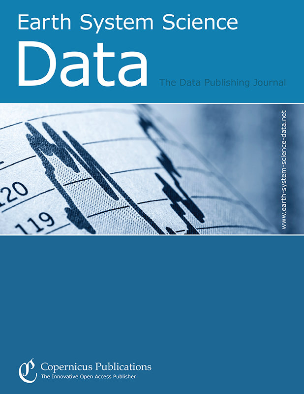
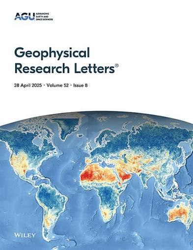

<i>Current Version – <b>v.1.1</b></i> 
<b>Dataset (v.1.1):</b>
<a href="https://doi.org/10.5281/zenodo.23067127" target="_blank">10.5281/zenodo.23067127</a>

!!! success ""
    NEW: The <strong>[GRAIN Visualizer](https://uw-saswe.github.io/GRAIN-Visualizer/)</strong> website is now LIVE.

<h4>What is GRAIN?</h4>

GRAIN (Global Registry of Agricultural Irrigation Networks) provides an open, globally consistent map of surface irrigation canals derived from OpenStreetMap (OSM) and enhanced with machine learning.
The dataset spans 95 countries and includes over 3.8 million km of canal networks, classified by use type (agricultural, urban, navigation) and validated against regional inventories.   

 This website serves as a documentation portal for GRAIN, and contains information on the following:
<!-- 
<ul>
  <li>GRAIN Workflow and Data Sources</li>
  <li>Reproduction of GRAIN Workflow</li>
  <li>GRAIN Dataset Structure</li>
  <li>Reading and Vizualising GRAIN data</li>
  <li>Download links</li>
</ul> -->

-   :octicons-workflow-16:{ .lg .middle } __Methodology and Datasets Used__

    ---

    Brief details on the methodology and datasets used to generate the GRAIN dataset.

    [:octicons-arrow-right-24:](./grain_methodology.md)

-   :material-database-cog:{ .lg .middle } __Reproduce Workflow__

    ---

    Step-by-step explanation of how to recreate GRAIN data for a sample region.

    [:octicons-arrow-right-24:](./reproduce_workflow.md)

-   :material-table-of-contents:{ .lg .middle } __Dataset Structure__

    ---

    Information on the GRAIN Dataset Attribute Schema. 

    [:octicons-arrow-right-24:](./attribute_schema.md)

-   :material-language-python:{ .lg .middle } __Reading GRAIN__

    ---

    Instructions on how to read and visualize GRAIN data using Python and QGIS.

    [:octicons-arrow-right-24:](./reading_grain.md)

<h4>Related Publications</h4>

<a class="pub-link" href="https://essd.copernicus.org/articles/18/1855/2026/" target="_blank">

GRAIN – a Global Registry of Agricultural Irrigation Networks
Suresh, S., Hossain, F., Mishra, V., &amp; Hossain, N. (2026)
<i>Earth System Science Data</i>

</a>

<button type="button" class="pub-cite-toggle" aria-haspopup="true" aria-expanded="false"><svg viewBox="0 0 24 24" aria-hidden="true"><path d="M19 21H8V7h11m0-2H8a2 2 0 0 0-2 2v14a2 2 0 0 0 2 2h11a2 2 0 0 0 2-2V7a2 2 0 0 0-2-2m-3-4H4a2 2 0 0 0-2 2v14h2V3h12V1Z"/></svg>Cite</button>

<button type="button" data-cite="essd" data-format="apa">Copy as text (APA)</button>
<button type="button" data-cite="essd" data-format="bibtex">Copy as BibTeX</button>

<a class="pub-link" href="https://doi.org/10.1029/2026GL124090" target="_blank">

How well can the Surface Water and Ocean Topography (SWOT) satellite mission observe irrigation canals?
Sharma, M., Hossain, F., Suresh, S., Pavelsky, T. M., Minocha, S., &amp; Khan, S. (2026)
<i>Geophysical Research Letters</i>

</a>

<button type="button" class="pub-cite-toggle" aria-haspopup="true" aria-expanded="false"><svg viewBox="0 0 24 24" aria-hidden="true"><path d="M19 21H8V7h11m0-2H8a2 2 0 0 0-2 2v14a2 2 0 0 0 2 2h11a2 2 0 0 0 2-2V7a2 2 0 0 0-2-2m-3-4H4a2 2 0 0 0-2 2v14h2V3h12V1Z"/></svg>Cite</button>

<button type="button" data-cite="grl" data-format="apa">Copy as text (APA)</button>
<button type="button" data-cite="grl" data-format="bibtex">Copy as BibTeX</button>

Codebase:
<a href="https://github.com/UW-SASWE/GRAIN/" target="_blank"><b>GRAIN GitHub Page</b></a>

